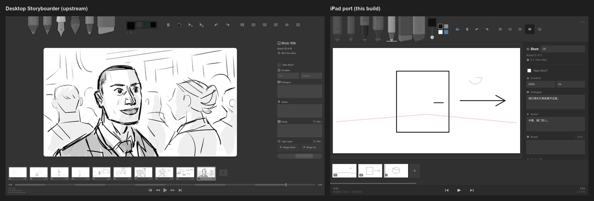
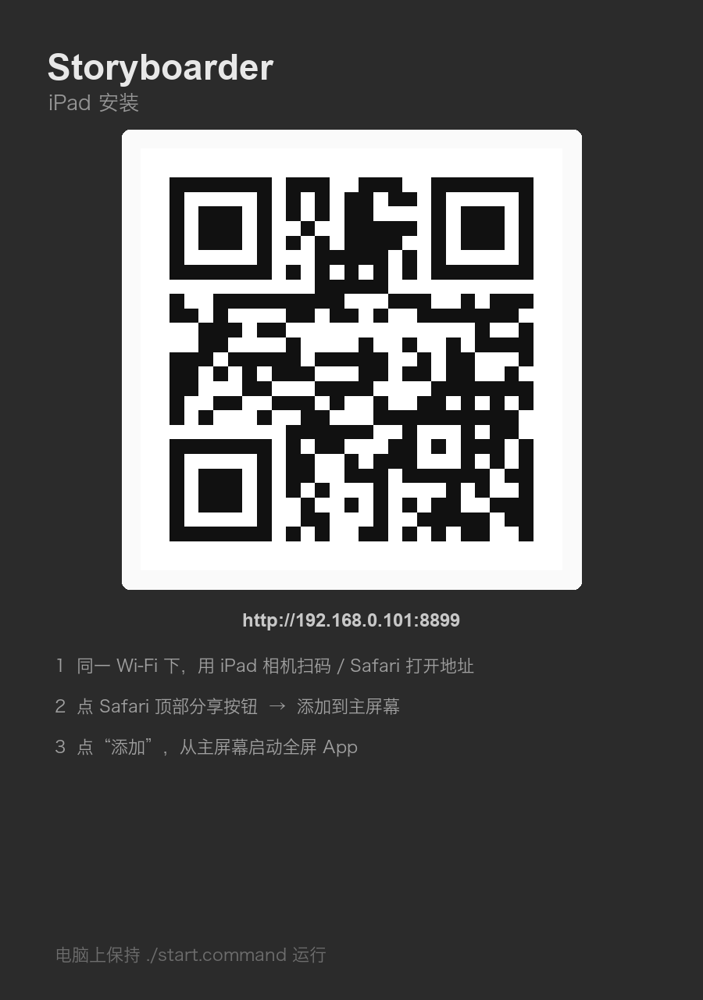

# Storyboarder · iPad

把 [wonderunit/storyboarder](https://github.com/wonderunit/storyboarder) 移植到 iPad。
iPadOS 跑不了 Electron，所以这是**按电脑版界面 1:1 还原 + 触控/Apple Pencil 重做**的版本：纯静态、零依赖，装到主屏幕即全屏 App。



## 界面（与电脑版一致）

| 电脑版 | iPad 版 |
|---|---|
| 顶部笔刷工具栏（7 支笔 + 颜色 + 笔刷大小 + 撤销/清空 + 参考线） | 同位置，同样用上游的笔刷贴图与图标 |
| 中间白色画板 | 同，16:9，Apple Pencil 压感 |
| 右侧 Board Metadata（Shot / Board / line miles / New Shot? / Duration / Dialogue / Action / Notes / Layer 合并 / Scene 帧率） | 同，竖屏时收进抽屉 |
| 底部 Boards 缩略图条 + 播放条（时间码 / 上一板 / 播放 / 下一板） | 同，缩略图显示镜头号（1A / 1B / 2） |

工具 → 图层：Light Pencil→reference、Fill Brush→fill、Tone→tone、Pencil→pencil、Ink Marker→ink、Note Pen→notes；橡皮擦当前层；另有油漆桶填充、网格 / 中心线 / 三分线 / 洋葱皮 / 台词字幕开关。

## 安装到 iPad（3 步）



1. **Mac**：双击 `start.command`（或终端 `./start.command`），保持窗口运行。它打印局域网地址，例如 `http://192.168.0.101:8899`。
2. **iPad**：连同一个 Wi-Fi，用相机扫上面二维码（或 Safari 直接输入地址）打开。
3. **安装**：Safari 工具栏的 **分享 ⤴** → **添加到主屏幕** → **添加**。之后从主屏幕启动就是全屏 App。

> 想离线使用 / 用系统分享面板导出 PDF：`./start-https.command`，iPad 打开 `https://<IP>:8443`，证书警告点「显示详细信息 → 继续访问」。
> 换 Wi-Fi 或 IP 变化时重新运行脚本、重新扫码即可。

## 导出 & 存档

右上 `⋯` 打开导出菜单：

| 格式 | 内容 |
|---|---|
| **PDF** | 多页 16:9 故事板，可 AirDrop / 存到「文件」/ 打印 |
| **PNG** | 逐帧图片；多板自动打包 zip，单板直接给 PNG |
| **GIF** | 按板时长生成的动图预览（480×270，循环） |
| **MP4** | 原生 H.264 视频（30fps，按板时长），仅 App 版 |
| **WEB** | 单文件 HTML：带头图、Action / Dialogue 字幕，可分享给别人直接看 |
| **Fountain** | `.fountain` 剧本（Action 段落 + Dialogue 居中行 + Notes） |
| **CSV** | Shot List 表格：Board / Shot / Duration / Dialogue / Action / Notes |
| **JSON** | 工程备份，可再导入；App 版还会镜像一份到「文件 → Storyboarder」 |

工程自动保存到 IndexedDB（App 版额外写 Documents），换设备前导出一份 JSON。

App 图标与网页版图标均使用上游官方 logo（`build/icon.png`），不是另画的。

## 快捷键（接键盘时）

`1–7` 选笔 · `[` `]` 笔刷大小 · `O` 洋葱皮 · `G` 网格 · `⌫` 清空画板 · `←/→` 切板 · `空格` 播放 · `⌘Z` / `⇧⌘Z` 撤销重做


## 原生 iPad App（Xcode）

`ios/` 里是一个 SwiftUI + WKWebView 的原生壳：所有网页资源打包进 App（完全离线），内置 `127.0.0.1` 本地 HTTP 服务加载页面，并加了原生桥（分享面板导出 PDF/PNG/JSON、工程镜像到「文件」、绘制时防锁屏、全屏隐藏 Home 条）。

```bash
cd ios
./build.sh            # 编译（iOS Simulator）
./build.sh device     # Release 构建 + 打包未签名 ipa
./build.sh run        # 安装并启动到 iPad 模拟器
```

安装到真机：打开 `ios/Storyboarder.xcodeproj` → Signing 选自己的 Team → 连 iPad → Run（详见 [ios/README.md](ios/README.md)）。

## 说明

- 画布 1280×720，导出 PDF 每页即 16:9
- 字体（THICCCBOI）、笔刷图片、图标来自上游仓库，版权归 Wonder Unit，仅作界面还原；本移植与上游无隶属关系
- 想要真正的 .ipa（App Store / TestFlight）：项目已是纯静态结构，套 [Capacitor](https://capacitorjs.com) `npx cap add ios` 后用 Xcode 打包即可（本机未安装 Xcode，所以没做签名）

上游项目：MIT · [wonderunit/storyboarder](https://github.com/wonderunit/storyboarder)
